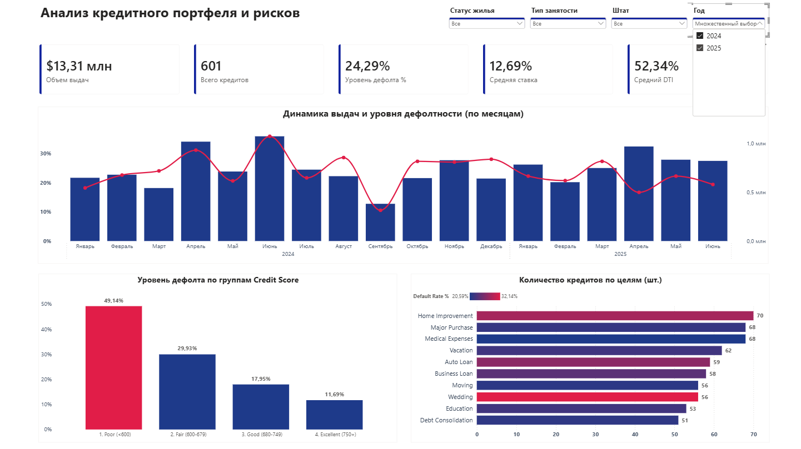

# 📊 Credit Risk & Portfolio Analytics

| Dashboard Overview (2024–2025) | Data Model & Star Schema |
| :---: | :---: |
|  |  |

## 📌 Executive Summary
Комплексное BI- и риск-аналитическое решение для финансового департамента и службы риск-менеджмента банка. Проект диагностирует качество кредитного портфеля, выявляет зоны финансовых потерь и предоставляет руководству инструменты для оптимизации кредитной политики.

---

## 💼 Business Questions, Solutions & Impact (Google XYZ Framework)

| Business Question (Задача) | Solution & Methodology (Как решали — Doing Z) | Business Impact & Value (Польза для бизнеса — Achieved X, Measured by Y) |
| :--- | :--- | :--- |
| **1. Какова общая подверженность банка кредитным рискам?** | Разработаны SQL-скрипты очистки данных (`TRY_CAST`, `ISNULL`) и спроектирована звезда (`dim_borrowers` + `fact_loans`), агрегирующая 601 кредит на сумму $13.31M. | **Выявлен критический уровень дефолта (24.29%)** по портфелю, что сигнализирует менеджменту о необходимости срочного пересмотра процентной политики. |
| **2. Какие группы заемщиков генерируют наибольшие убытки?** | Настроена сегментация клиентской базы в Power BI/DAX по кредитному скорингу (`credit_score` от Poor до Excellent). | **Локализована первопричина потерь:** сегмент `Poor (<600)` дает дефолтность **49.14%**, что позволяет внедрить прямой стоп-фактор по выдачам. |
| **3. Как долговая нагрузка (DTI) влияет на стабильность портфеля?** | Проанализированы коэффициенты долговой нагрузки заемщиков (`dti_ratio`) и цели кредитования (`loan_purpose`). | **Обнаружен высокий средний DTI (52.34%)**, давший риск-комитету обоснование для жесткого лимитирования выдач перекредитованным клиентам. |

---

## 🛠 Tech Stack & Implementation
* **SQL Server (T-SQL):** Проектирование реляционной схемы, обеспечение целостности (`PRIMARY KEY`, `FOREIGN KEY`), очистка аномалий.
* **Power BI & DAX:** Построение звезды, написание агрегирующих мер и визуальная иерархия.

### Ключевые DAX-меры:
```dax
Total Volume = SUM(fact_loans[loan_amount])
Total Loans = COUNT(fact_loans[loan_id])
Total Defaults = SUM(fact_loans[is_default])
Default Rate % = DIVIDE([Total Defaults], [Total Loans], 0)
---

```

├── Data/
│   └── raw_data.csv
├── Power BI/
│   └── credit_risk_dashboard.pbix
├── Screenshots/
│   ├── 2024-2025.png
│   └── schema and data.png
└── Sql/
    └── DDL_DML_and_queries.sql
